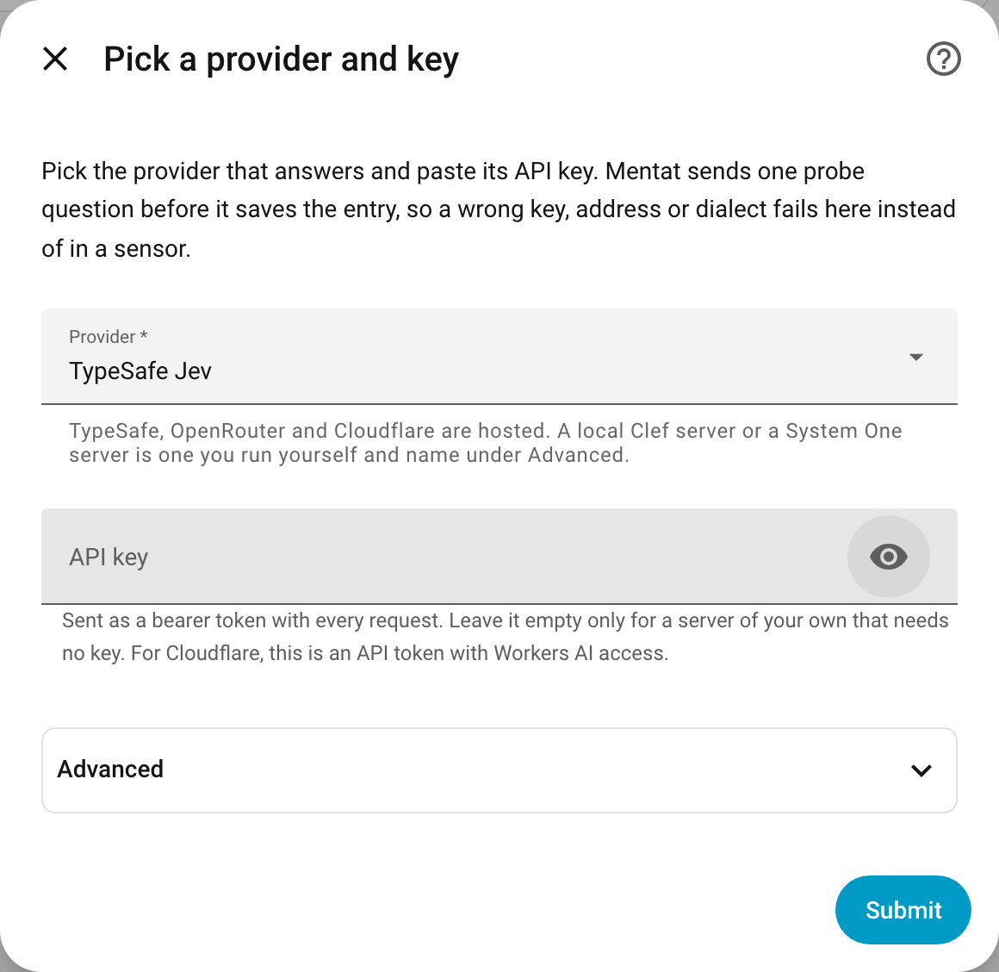
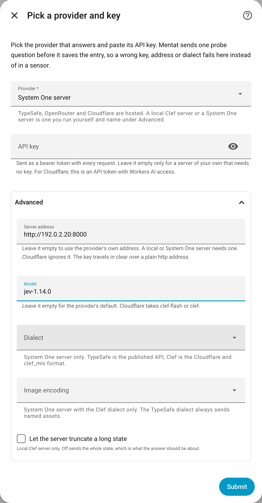
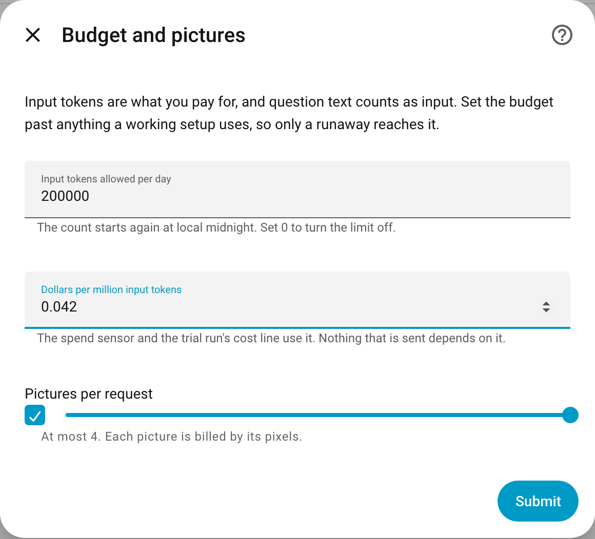
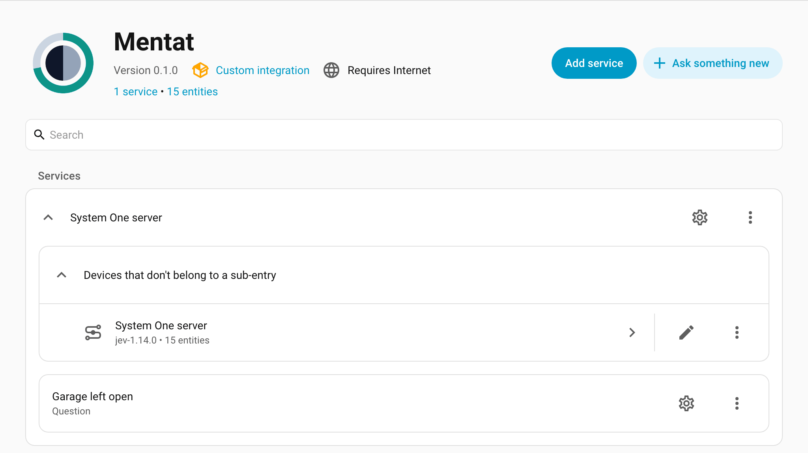
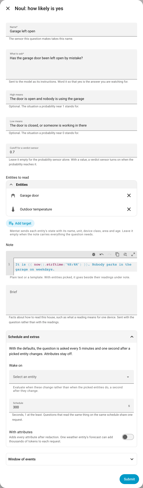
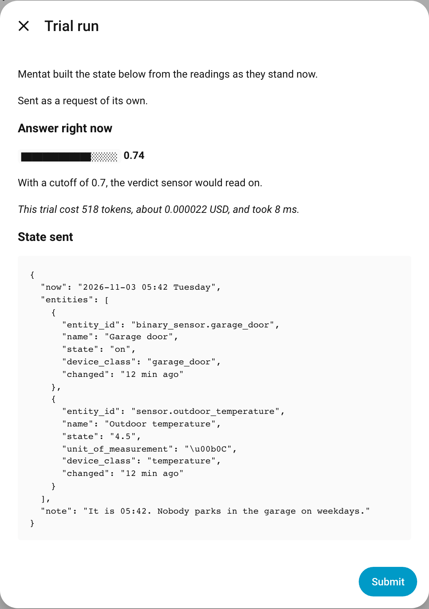
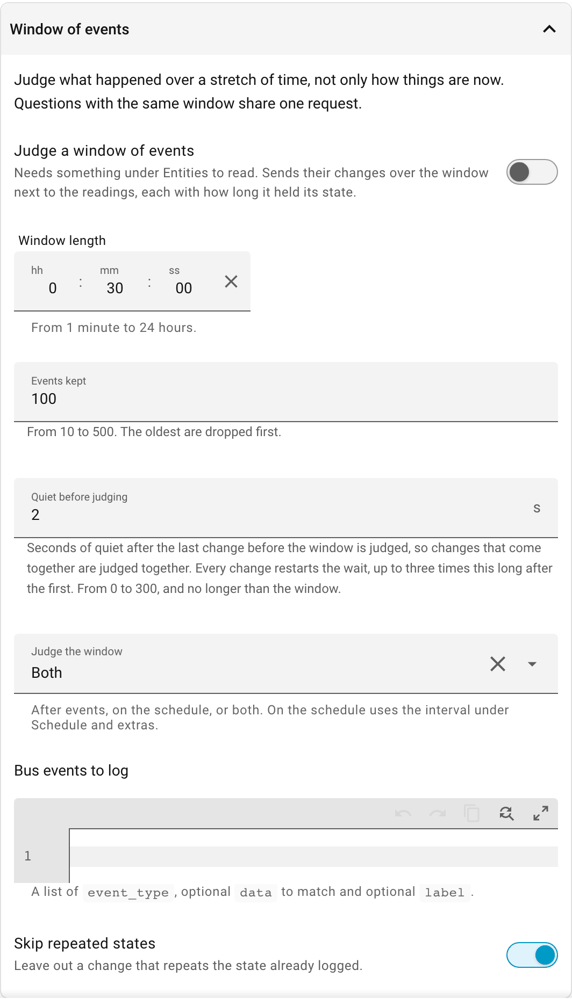
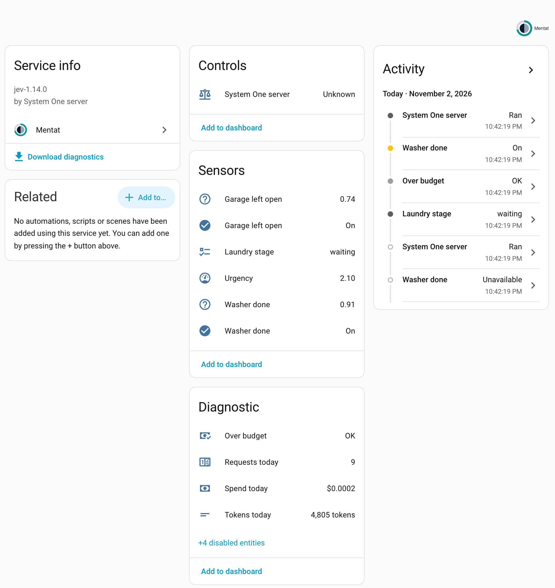
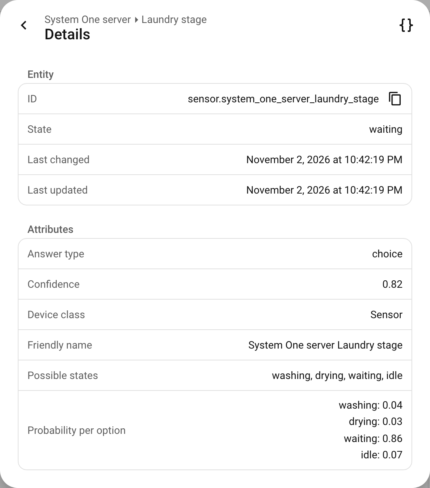
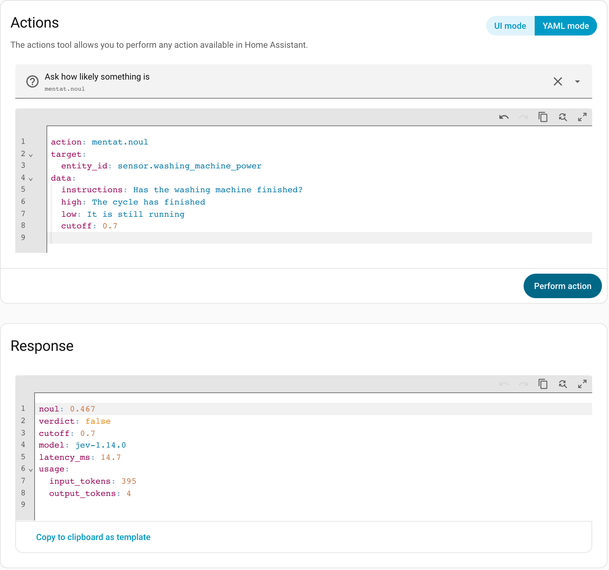

# Mentat

Mentat connects Home Assistant to a System One decision model such as Jev or Clef.
You write a question about your home in plain language. The model answers with a
typed value: a probability, one option out of a set, or a level on a scale you
define. It never writes prose, so an automation can act on the answer without
parsing a sentence.

The domain is `mentat`. Because every answer evaluation costs tokens on hosted providers,
Mentat counts input tokens, estimates the cost, and refuses a request that would
go over your daily budget before it is sent. There is no budget until you set one
in the entry's options.

The screenshots in this README come from a test instance whose server returns
made-up answers. The forms, entities and responses are Mentat's own.

## Question types

| Type | Answer | Entity |
| --- | --- | --- |
| `noul` | A probability from 0 to 1 that the statement is true. | A sensor with the probability. With a `cutoff`, also a verdict binary sensor that is on once the probability reaches it. With a `release` as well, the verdict turns off only below the release. |
| `choice` | One of 2 to 255 options, with a confidence and the probability of every option. | A sensor whose state is the winning option. |
| `score` | A weighted level on 2 to 10 levels you list lowest first, with the nearest level and a confidence. | A sensor with the weighted level and the levels as a legend. |

The actions also take a fourth type, `box`, which finds one thing in a picture and
returns its edges. YAML watches and the question editor do not offer it.

A noul's probability is the whole answer, so it has no confidence. A choice or
score carries `confidence` beside its answer. Neither is calibrated: watch real
answers for a while before you pick a cutoff.

A verdict with only a cutoff flips each time the probability crosses it, so an
answer that wobbles around 0.7 can turn it on and off on every evaluation. Give
it a `release` below the cutoff and it holds between the two: on at or over the
cutoff, off under the release, and whatever the last answer left it in between.
TypeSafe's documentation suggests 0.7 for yes and 0.3 for no as a starting
point; Mentat has not measured either. Once the recorder has a few days of a
noul's answers, [mentat.calibrate](#mentatcalibrate) measures them against an
entity that shows the truth and suggests both numbers for that house. Nothing is
held across a restart, as no answer is, so a first answer inside the band leaves
the verdict unknown until one lands outside it.

A choice or score always gives its likeliest answer, however unsure. Give it a
`min_confidence` and an answer under that shows no value on the sensor: a score
reads unknown, and a choice reads its `fallback`, or unknown without one. The
`fallback` is your own word for "the model could not tell", such as `unsure`, or
one of the options such as `other`. A word of your own joins the sensor's states
and is never sent to the model. The model's answer stays in the attributes, with
`confident: false` beside it and `leaning` naming what it would have said, so an
automation can ask a person to confirm. A choice can give an option a higher bar
than the rest, because some answers cost more to get wrong:

```yaml
min_confidence:
  default: 0.5     # every option you do not name
  leaving: 0.85    # this option must clear a higher bar
fallback: other
```

## Providers and dialects

| Provider | Dialect | What you enter |
| --- | --- | --- |
| TypeSafe Jev | TypeSafe | API key |
| OpenRouter | TypeSafe | API key |
| Cloudflare Workers AI, Clef or Clef-flash | Clef | API token with Workers AI access, and the 32 character account id |
| Local Clef server | Clef | The server's address; a key only if it asks for one |
| System One server | TypeSafe or Clef, your choice | The server's address, the dialect, and a key if it needs one |

A dialect is the wire format. TypeSafe is the published `/v1/systemone` API, where
pictures travel as named assets that the state refers to. Clef sends pictures as an
ordered list before the state and may wrap the reply in Cloudflare's
`{success, result, errors}` envelope.

A local Clef server is one you run yourself, for example a `/v1/systemone` server
on a Mac on your network at `http://192.0.2.20:8000`. Requests to it cost nothing,
so its price defaults to 0. A System One server also defaults to 0; set its price
in the options if it bills you.

## Install

Mentat lives on [GitLab](https://gitlab.com/tdjones8081/ha-mentat) and is mirrored
to [GitHub](https://github.com/tdjones/ha-mentat) for HACS. Report problems on
GitLab.

### With HACS

Mentat is not in the HACS default list yet. Add it as a custom repository:

1. In HACS, open the menu in the top right corner and pick Custom repositories.
2. Enter `https://github.com/tdjones/ha-mentat`, pick the Integration type and add it.
3. Find Mentat in HACS, download it and restart Home Assistant.

HACS offers each release and tells you when a new one is out.

### By hand

1. Copy `custom_components/mentat` from this repository into
   `/config/custom_components/mentat` on your Home Assistant host.
2. Restart Home Assistant.

From a clone, `make deploy HA_HOST=root@192.0.2.10` copies the folder over SSH.
It needs an SSH app on the host. `HA_CONFIG` changes the target folder from
`/config`.

Mentat needs Home Assistant 2026.9 or later.

## Setup

Go to Settings, Devices & services, Add integration, and pick Mentat. Choose a
provider and paste its key. Cloudflare asks for the account id on a second page.



For a local or System One server, open Advanced:

- **Server address.** An http or https address with a host and an optional path.
  Spaces, a query, a fragment, a user name or a password are refused, and a
  trailing slash is dropped. Cloudflare ignores the field. A key sent to a plain
  http address travels in clear.
- **Model.** Empty asks for the provider's default. Cloudflare takes only
  `clef-flash` or `clef`.
- **Dialect.** System One server only.
- **Image encoding.** System One server with the Clef dialect only: a data URL
  list, as `clef_mlx.py` reads, or base64 objects, as Workers AI reads. The
  TypeSafe dialect always sends named assets.
- **Let the server truncate a long state.** Local Clef server only. Leave it off
  so the model reads the whole state.



Setup sends one short probe question, so a wrong key, address or dialect fails
before the entry is saved. The probe bills about 143 input tokens on clef-flash and
273 on TypeSafe, which at TypeSafe's price is about a thousandth of a cent. The
same probe runs every time the entry loads: at start, on a reload, and after any
change to the options or to a question. It counts against the day's budget and is
skipped once the budget is spent.

The same server and key cannot be added twice. A second entry for the same
provider with another key is allowed. Both name their device after the provider,
so the second entry's entity ids end in `_2`.

### Options

The entry's options hold the money settings:

- **Input tokens allowed per day.** 0, the default, turns the limit off. The
  count starts again at midnight in your Home Assistant time zone.
- **Dollars per million input tokens.** The spend sensor and the trial run's cost
  line use it. Nothing that is sent depends on it.
- **Pictures per request.** 0 to 4. 0 turns pictures off for this entry.



### Reauthenticate and reconfigure

A rejected key starts reauthentication, which asks for the key alone and probes
the saved address with it. Reconfigure changes the provider, key, address, model,
dialect, image encoding and the truncate switch, and keeps your questions. Leave
the key empty to keep the saved one; that works only while the provider and the
address stay the same. Both probe before they save.

## Questions in the UI

On the Mentat entry, choose Ask something new. Each question is a sub-entry of
the entry and makes its own sensor.



Pick the answer type, then fill in the form:

- **Name.** The sensor takes this name.
- **What to ask.** The instructions. For a noul, word it so that yes is the
  answer you are watching for.
- **High means** and **Low means**, for a noul: what a probability near 1 and
  near 0 stand for. Both are optional.
- **Cutoff for a verdict sensor**, for a noul. Empty gives the probability sensor
  alone. With a value, a verdict binary sensor turns on at that probability.
- **Verdict turns off below**, for a noul with a cutoff. Empty turns the verdict
  off below the cutoff. A lower value holds it in between, as under
  [Question types](#question-types) describes. It cannot be over the cutoff.
- **Options**, for a choice: one per line as `name: what it means`. The
  description is optional. 2 to 255 lines, no line may start with a colon, and no
  name may appear twice.
- **Levels**, for a score: one per line, lowest first, 2 to 10 of them.
- **Lowest confidence to show**, for a choice or a score. Empty shows every answer.
  Under it, the sensor shows the fallback, or unknown. A bar per option is written
  in YAML only, because the form cannot check option names against the Options box
  as you type.
- **Fallback state**, for a choice with a lowest confidence: one of your options, or
  a word of your own.
- **Entities to read.** Pick by entity, device, area or label. Each entity goes
  out with its state, name, unit, device class, area and how long ago it changed.
- **Note.** Text or a template, sent beside the readings under `note`. With no
  entities picked, the note is the whole state.
- **Brief.** Standing facts about how to read this house, sent with the question
  rather than with the readings.

A question needs entities, a note or both.



Under Schedule and extras, a question asks every 5 minutes by default and a
second after a picked entity changes:

- **Wake on.** Ask when these entities change instead of when the picked ones
  do. Still a second after the change. Use it when you read a power meter or
  anything else that reports every few seconds: without it, each report wakes
  the question, and the debounce only folds changes that land within the same
  second.
- **Schedule.** 1 second to 86,400 seconds, a day. The daily budget, not the
  interval, limits the spend.
- **With attributes.** Adds every attribute after redaction. One weather entity's
  forecast can add thousands of tokens to every request.

A watch never asks twice at once: whatever wakes it while a request is out is
answered by one more request after it. A change to a Mentat entity, of any entry,
never wakes a question or enters a window's log, even when the target picks it;
its state is still sent.

### Sharing a request

Questions that read the same thing share one request. The same thing means the
same entities, note, wake on, schedule, attributes switch and window. Change any
of those on one question and it gets a request of its own.

A question alone in its request names its diagnostic sensors after itself. A
group of two or more is named Group 1, Group 2 and so on.

### Trial run

The last page shows the state the question sends and asks it once, so you see a
real answer and its cost before saving. It also says which saved questions it
would share a request with, and for a window, how many events the recorder
already holds. The trial counts against the budget like any other request. A
failed trial, a spent budget or a template error is reported on the page and does
not stop you from saving.



The state on this page is cut at 1,800 characters. The bytes diagnostic sensor
carries the whole of it after the question runs.

### Revising and removing

The gear on a question opens Revise question, the same form with the same
sections. The answer type cannot change; make a new question for that. Renaming a
question keeps its entities and their ids. Delete a question from its menu.

Saving, revising or deleting a question reloads the entry. Every watch asks again
and the probe runs once more.

## Questions in YAML

Each item under `mentat:` is a watch: one request per evaluation, with every
question in it judged against the same state. One Mentat entry runs every YAML
watch. At start it is the oldest enabled entry that loads. When that entry is
disabled, removed or fails to load, the next loaded entry reloads and takes
them over. Their entities keep their entity ids and settings, and move to the
new entry's device. With no Mentat entry at all, YAML watches do not run.

```yaml
mentat:
  - name: Laundry
    # Entity ids, or a target with entity_id, device_id, area_id, floor_id, label_id.
    entities:
      - sensor.washing_machine_power
      - sensor.dryer_power
      - binary_sensor.laundry_door
    # Optional text or template, sent next to the readings as `note`.
    note: >-
      The washer idles under 5 W. It is {{ now().strftime('%A') }}.
    scan_interval: 300          # seconds, 1 at the least; default 300
    wake_on: []                 # ask when these change instead of the entities above
    with_attributes: false      # every attribute costs tokens on every request
    fire_event: true            # fire mentat_decision after each answer
    questions:
      - name: Washer done
        type: noul
        instructions: Has the washing machine finished its cycle?
        brief: A cycle ends with power under 5 W for two minutes.
        high: The cycle has finished and the drum is idle
        low: The machine is still washing, rinsing or spinning
        cutoff: 0.7                 # the verdict turns on at or over this
        release: 0.3                # and off under this; in between it holds
      - name: Laundry stage
        type: choice
        instructions: Where is the laundry right now?
        criteria:
          washing: The washer is running
          drying: The dryer is running
          waiting: A machine finished and nobody has opened its door
          idle: Neither machine has run recently
        min_confidence: 0.5         # under this the sensor shows the fallback
        fallback: unsure            # a choice only; a score reads unknown
      - name: Urgency
        type: score
        instructions: How soon should someone move the laundry?
        criteria:
          - No need
          - Within a few hours
          - Within the hour
          - Now, before it creases
```

`instructions`, `brief`, `high`, `low` and each scale level may also be a mapping
or a list instead of text. A text brief reaches the model under the key
`background`; a mapping brief keeps your own keys.

The question entities take the entry's name and the question's name, for example
`sensor.typesafe_jev_washer_done` and `binary_sensor.typesafe_jev_washer_done`.
The id is fixed when the entity is first made. Renaming a YAML watch or question
makes a new entity and removes the old one with its customisations, because the
name is the key.

`examples/` holds worked setups: `laundry.yaml`, a plain watch with an
automation on its decision; `house_mode.yaml`, a window watch with three
questions; `package_check.yaml`, a porch package check with pictures;
`actions.yaml`, a script for each action; and `ai_task.yaml`, an
`ai_task.generate_data` call.

### What YAML refuses

Mentat checks the block when Home Assistant reads it, and refuses:

- an unknown key anywhere;
- a watch with neither `entities` nor `note`, or with no questions;
- two watches whose names slug alike, such as `House mode` and `house-mode`, and
  two questions in one watch that do;
- two questions anywhere whose keys collide. A key is the watch slug and the
  question slug joined, so `House mode` with `Quiet` collides with `House` with
  `Mode quiet`;
- a choice whose `criteria` is not a mapping of 2 to 255, a score whose `criteria`
  is not a list of 2 to 10, and `criteria` on a noul;
- a `cutoff` or `release` outside 0 to 1, a `release` with no `cutoff` or over
  it, and either one on a choice or a score;
- a `min_confidence` outside 0 to 1, or on a noul, a mapping of them on a score,
  one naming no option of the choice, and a `fallback` with no `min_confidence` or
  on a score;
- a `scan_interval` under 1 or not a whole number, and a `note` that is not a
  valid template;
- an unquoted `yes`, `no`, `on` or `off` used as a word under `high`, `low` or a
  scale level. YAML reads them as true or false, so quote them, as in
  `high: "on"`;
- the window rules under [Windows of events](#windows-of-events).

A refused block stops the whole integration from loading, not only the YAML
watches. The editor's questions go unavailable and the actions are not
registered until the block is fixed. Run Developer tools, YAML, Check
configuration before you restart.

YAML is read once at start. There is no reload action; restart Home Assistant
after you change a watch. Reloading the entry reuses the YAML it read at start.

## Windows of events

A plain watch judges how things are now. A window watch also judges what
happened over the last stretch of time. It keeps a log of state changes of its
entities and of the bus events you name, and sends that log with the readings.

```yaml
mentat:
  - name: House mode
    entities: [person.alex, person.sam, binary_sensor.hall_motion, binary_sensor.front_door]
    scan_interval: 600
    window:
      duration: "01:00:00"   # 1 minute to 24 hours
      max_events: 150        # 10 to 500, the oldest dropped first; default 100
      settle: 20             # seconds of quiet before judging, 0 to 300; default 2
      evaluate: both         # on_event, interval or both; default both
      events:
        - event_type: doorbell_pressed
          data: {button: front}   # matches events whose data holds these values
          label: someone rang the front doorbell
    questions:
      - name: Everyone asleep
        type: noul
        instructions: Has everyone at home gone to bed for the night?
        cutoff: 0.6
```

- `on_event` asks once the log has been quiet for `settle` seconds. Every change
  restarts the wait, so a burst of changes is one evaluation. A log that never
  goes quiet is judged three settle periods after the first change still
  waiting. With `settle: 0`, every change is an evaluation. `on_event` has no
  schedule.
- `interval` keeps logging and asks only on `scan_interval`, which you must
  write out for it.
- `both` does both, on the default schedule of 300 seconds unless you set one.
- `settle` cannot be longer than `duration`.
- A window needs `entities`. It logs at most 100 of them, in id order, and a
  target that expands past 100 is refused when it is judged.
- With `wake_on`, the window logs changes to the `wake_on` entities instead of
  the target's. The readings still come from the target.
- A window cannot log `mentat_decision` or any other `mentat_` event: the
  watch would ask again after each of its own answers.
- `with_attributes` and `collapse_repeats` also go under `window:`. There,
  `with_attributes` adds attributes to each log row; the watch's own
  `with_attributes` adds them to the entity records. `collapse_repeats` defaults
  to true and skips a change that repeats the state already logged.

The model receives the time, a summary of the window, the entities and the log.
The summary gives the window's start, end, length in minutes, event count and
whether old events were dropped to stay under `max_events`. Each entity carries
how long it has held its state and how often it changed in the window. A binary
sensor also carries how long it was on and when it last was. Each log row has
its time, how long ago that was, and the entity's old and new state, or the bus
event's label and data. Mentat works these out so the model does not have to
subtract timestamps.

At start the log is filled from the recorder with significant state changes, so
a restart does not empty it. Bus events are not in the recorder, so they start
empty. Without the recorder, or if reading it fails, the log starts empty and the
log says why.

The question editor has the same settings in its Window of events section. There
the window follows the question's With attributes switch.



## Entities

Each entry makes one service device named after the entry. Every entity below
belongs to it.



| Entity | State | Attributes |
| --- | --- | --- |
| Noul question sensor | The probability, to 3 places | `question_type` |
| Verdict binary sensor | On once the probability reaches the cutoff, off under the release, held in between | `probability`, `cutoff`, and with a release `release` and `held` |
| Choice question sensor | The winning option, an enum sensor, or under its `min_confidence` its `fallback` or unknown | `question_type`, `options`, `confidence`, `probabilities`, and with a `min_confidence` `confident`, and under it `leaning` |
| Score question sensor | The weighted level, counted from 0 for the lowest, or unknown under its `min_confidence` | `question_type`, `confidence`, `probabilities`, `normalized`, `legend`, `nearest_level`, and with a `min_confidence` `confident`, and under it `leaning` |
| Requests today | Requests billed since midnight | |
| Tokens today | Input tokens billed since midnight | `token_budget` |
| Spend today | An estimate in US dollars | `token_price` |
| Over budget | A problem binary sensor | `token_budget`, `tokens_today` |
| Latency, per watch | The last request's latency, diagnostic, off by default | |
| Bytes, per watch | The size of the last body, diagnostic, off by default | `sent_state`, the exact state sent, and `questions` |
| AI Task | See [AI Task](#ai-task) | |

A score's `probabilities` and `legend` are keyed by level number as text, `"0"`
for the lowest. `normalized` is the score over its top level, from 0 to 1, so
scores with scales of different lengths can be weighed together in a template.
`held` is true when the verdict kept its last state because the probability sat
between release and cutoff. A window watch's question and verdict entities also carry
`window_start`, `window_end`, `event_count` and `last_evaluated`. Confidence is
rounded to 3 places and probabilities to 4. Mentat keeps these attributes out of
the recorder.



A question entity with no answer to its own question is unavailable. It never
shows a stale or made-up value. It goes unavailable when:

- the request failed or was refused, for example over budget;
- the reply had no answer under its key, or an answer of the wrong type;
- a choice came back with an option it does not list;
- Home Assistant is still starting, or has started and the watch has not answered
  yet. A watch asks nothing until Home Assistant has started, because other
  integrations are still adding the entities it reads. Mentat does not restore an
  old answer after a restart.

A verdict whose first answer since a restart lands between release and cutoff
reads unknown rather than unavailable: its probability sensor has an answer, and
nothing yet says which side of the band the verdict was on. A choice or score under
its `min_confidence` with no fallback reads unknown for the same reason: an answer
came back, and it was not sure enough to show.

A watch that nothing reads is not asked at all: one with `fire_event: false`
whose question, verdict and diagnostic entities are all disabled. A watch that
fires `mentat_decision` is always asked, because an automation may be reading
the event. Questions from the editor always fire it.

## The decision event

Every answered evaluation fires `mentat_decision`. A failed or refused one fires
nothing.

```yaml
entry_id: 01J...            # the Mentat entry
watch: house_mode           # the watch's name, slugified
watch_name: House mode
answers:
  house_mode_everyone_asleep:   # watch key and question name
    type: noul
    noul: 0.83
    name: Everyone asleep
    verdict: true               # only for a noul with a cutoff, once it is known
    held: false                 # only for a noul with a release
window: {start: "...", end: "...", events: 42}   # null for a plain watch
model: jev-1.14.0
latency_ms: 274.0
input_tokens: 3120
```

A choice answer carries `choice`, `confidence` and `probabilities`. A score
answer carries `score`, `normalized`, `nearest_level`, `confidence`, `legend` and
`probabilities`. With a `min_confidence`, either also carries `confident`, and the
answer itself stays the model's, whatever the sensor shows. A question the reply left out is missing from `answers`.
Trigger on the decision rather than on a sensor's every change:

```yaml
automation:
  - alias: Night scene when everyone is asleep
    triggers:
      - trigger: event
        event_type: mentat_decision
        event_data:
          watch: house_mode
    conditions:
      - "{{ trigger.event.data.answers.house_mode_everyone_asleep.verdict }}"
    actions:
      - action: scene.turn_on
        target:
          entity_id: scene.night
```

An editor question's watch key is `ui_` and a hash of its settings, and its
answer key is `ui_` and its sub-entry id, so neither reads like its name. Match
its event on `watch_name`, which is the question's name while it has a request
of its own, and find the answer by its `name`:

```yaml
conditions:
  - "{{ trigger.event.data.answers.values() | selectattr('name', 'eq', 'Garage left open')
        | map(attribute='verdict') | first | default(false) }}"
```

Revising a question's entities, note, schedule or window changes its watch key.

## Actions

Every action returns its answer as a response and needs `response_variable`.
Each that asks the model takes `config_entry` when more than one Mentat entry is
loaded, and `model` to use another model for that one request.
`mentat.calibrate` asks nothing and takes neither.



`noul`, `choice`, `score` and `ask` read the same kinds of input. Give at least one
of a target, `note` or `pictures`:

| Field | What it is |
| --- | --- |
| target | Entities, devices, areas, floors or labels to read. |
| `note` | Text or a template. A template is rendered for an automation, a script or an administrator. For any other user calling from the developer tools or the API, it goes to the model as written, so it cannot read entities their permissions hide. |
| `pictures` | Up to four camera or image entities, or full paths of image files. See [Pictures](#pictures). |
| `with_attributes` | Send every attribute after redaction. Off by default. |

Every action takes `instructions` and an optional `brief`, except `ask`, where
each question has its own. `box` reads one `picture` and nothing else: no target,
note or attributes.

### mentat.noul

```yaml
action: mentat.noul
target:
  entity_id: sensor.washing_machine_power
data:
  instructions: Has the washing machine finished?
  high: The cycle has finished
  low: It is still running
  cutoff: 0.7
response_variable: answer
```

Returns `noul`, `verdict`, `cutoff`, `model`, `latency_ms` and `usage` with
`input_tokens` and `output_tokens`. `verdict` is true once `noul` reaches
`cutoff`, which defaults to 0.5.

### mentat.choice

```yaml
action: mentat.choice
data:
  note: "{{ states('sensor.last_error_message') }}"
  instructions: Which part of the system does this error come from?
  options: [network, storage, power, other]
response_variable: answer
```

`options` is a list of 2 to 255 names, or a mapping of each name to what it
means. A name with nothing after its colon has no description:

```yaml
  options:
    network: Wi-Fi, DNS or a router
    storage: A disk, a share or the database
    power:
    other:
```

Returns `choice`, `confidence`, `probabilities` and the same `model`,
`latency_ms` and `usage`. An optional `min_confidence`, one number or a mapping as
under [Question types](#question-types), adds `confident`. `choice` stays the model's
word either way, so a script reads `confident` and picks what to do. There is no
`fallback` here.

### mentat.score

```yaml
action: mentat.score
target:
  area_id: garage
data:
  instructions: How urgent is what the garage sensors show?
  scale: [Ignore, This week, Today, Wake someone]
response_variable: answer
```

`scale` lists 2 to 10 levels, lowest first. Returns `score`, `normalized` (the
score divided by the top level), `nearest_level`, `confidence`, `legend`,
`probabilities`, `model`, `latency_ms` and `usage`. An optional `min_confidence`, one
number, adds `confident`.

### mentat.ask

Several questions about one state in one request. Each question has a `type`
(`noul`, `choice`, `score` or `box`) and `instructions`; a choice or score takes
`criteria`, and `options` or `scale` work there too. A question may carry its own
`brief`, `high` and `low`. `window` reads the last stretch of time from the
recorder for this one call and needs a target. It takes the same keys as a
watch's window.

```yaml
action: mentat.ask
target:
  entity_id: [binary_sensor.front_door, binary_sensor.hall_motion]
data:
  window:
    duration: "00:30:00"
  questions:
    someone_left:
      type: noul
      instructions: Did someone leave the house in this window?
    who:
      type: choice
      instructions: Who was it most likely?
      criteria: {alex: Alex, sam: Sam, nobody: Nobody left}
response_variable: answer
```

Returns `answers`, keyed as you named the questions, plus `model`, `latency_ms`
and `usage`. Each answer carries its `type`. A noul given a `cutoff` also
carries `verdict` and `cutoff`, as `mentat.noul` returns them. A `release` is
refused, because an action keeps nothing from one call to the next to hold. A choice
or score given a `min_confidence` also carries `confident`. A `fallback` is refused,
because a response never swaps the model's answer for another. A box question needs `pictures` and its answer
has the edges and `confidence` but not the picture's size.

### mentat.box

```yaml
action: mentat.box
data:
  picture: camera.driveway
  instructions: The parked car
response_variable: answer
```

Returns `left`, `top`, `right` and `bottom` as fractions of the picture from its
top left corner, `confidence`, and the source picture's `width` and `height` in
pixels after it is turned upright. Multiply a fraction by the side to get pixels.

A box question always answers with a box, even when the thing is not in the
picture. When it may be absent, use `mentat.ask` with a noul beside the box on
the same picture, and read the noul first.

`box` works only on the TypeSafe dialect. A Clef entry refuses it before sending,
after it has fetched and resized the picture. Jev models older than 1.14 refuse
it with a 400; Mentat reports any 400 on a request with a box as a refused box
question, so check the model if the message surprises you.

### mentat.calibrate

Picks a noul's `cutoff` and `release` from what really happened, instead of a
guess. It reads the recorder: the noul sensor's history beside an entity whose
state shows when the answer really was yes, such as a door contact or a smart
plug's own running sensor. It replays the history through the verdict sensor's own
rule, hold included, for each pair of numbers in steps of 0.05. Nothing is sent,
so it costs no tokens and needs no budget.

```yaml
action: mentat.calibrate
data:
  sensor: sensor.mentat_load_waiting              # a noul's sensor
  truth: binary_sensor.washing_machine_running    # shows what was really true
  truth_state: "on"                               # the default
  days: 7                                         # the default
  grace: 300                                      # seconds, the default
response_variable: fit
```

The response has:

| Key | What it is |
| --- | --- |
| `cutoff`, `release` | The pair with the fewest flips among those within 10% of the best F1. When many tie, the middle of them, so an answer a little off its usual value lands on the same side. |
| `precision`, `recall`, `f1` | How much of the time on was true, how much of the true time was on, and the balance of the two. |
| `caught`, `missed` | How many separate stretches of true time the verdict turned on for, and how many it did not. |
| `false_alarms` | How many times it turned on with nothing true behind it. |
| `flips` | How many times it changed. |
| `without_release` | The same numbers for that cutoff alone, to show what the release buys. |
| `when_true`, `when_false` | The `low` and `high` of the probabilities that held for 80% of each side's time. |
| `overlap` | True when those two ranges meet, so no numbers separate the answers. Either the question needs rewording or the truth entity does not mean what the question asks. Check the truth first: a sensor that is on for seconds at a time rarely does. |
| `hours`, `hours_true`, `answers` | How much was measured. A result over two true stretches is noise, whatever it says. |

An answer comes after what it describes, by up to the watch's schedule, so the
truth counts as still holding for `grace` seconds after it ended, and `hours_true`
includes that time. Set it to about the watch's schedule. A longer grace also joins
short pulses into one visit: `grace: 600` makes a person sensor mean "someone was
here in the last 10 minutes". If the noul reads the truth entity itself, the result
shows how well the two agree, not whether either is right.

The 0.05 steps, the 10%, the 80% and the 300 second default are choices nobody has
measured. Time when the sensor held no number, such as unavailable while the
server was down, is left out. True time under an unknown verdict counts as missed,
because an unknown verdict triggers nothing.

It refuses a stretch with no time where both entities had a state, one where the
truth was never or always in `truth_state`, a sensor that recorded anything
outside 0 to 1, a user who may not read either entity, and a stretch of more than
50,000 changes. `days` goes up to 90, and the recorder keeps 10 by default, so
asking for more than it kept finds nothing older. Both limits are choices nobody
has measured.

## Pictures

`pictures` takes up to four sources, fewer if the entry's options say so. A source
is a camera or image entity, or the full path of an image file Home Assistant may
read, such as a file under `/media` or in a folder listed in
`allowlist_external_dirs`. A relative path or a `media-source://` address is not
a source. The state the model reads still lists them under `images`.

Mentat turns each picture upright from its EXIF data, flattens transparency onto
white, resizes it for the dialect and sends it as a JPEG. An animated picture
goes as its first frame. A picture smaller than the dialect's smallest side is
scaled up, and one whose JPEG is still too large shrinks by a quarter per side
until it fits. The size it is sent at is the size it is billed at, and its tokens
join the budget estimate.

| Dialect | Sent at | Largest source | Billed |
| --- | --- | --- | --- |
| TypeSafe | Sides from 280 to 1568 px, 16 MiB | 50 megapixels | 2 tokens per 28 px block; a 1920 x 1080 frame is 3,584 |
| Clef | Sides from 32 px, at most 1024 px and 1 megapixel, 4 MiB | 16 megapixels | 1 token per 32 px block plus 3, at most 1,024; the same frame is 579 |

A file larger than 50 MiB is refused without being read whole. `docs/measurements.md`
says where each figure comes from.

Mentat fetches the pictures at the same time and waits 10 seconds for each camera
or image entity, Home Assistant's own default. If any one fails, nothing is sent
and nothing is billed.

When a user calls an action from the UI or the API, a file path needs an
administrator, and a camera, image or target entity needs that user's permission
to read it. An automation is not limited, because each run starts without a
user. A script started by a user, from a dashboard button or with their token,
runs as that user and is checked like them.

So a dashboard button for a user who is not an administrator, running a script
that passes a file path or a camera outside their permissions, is refused. To
allow it, have the button call `automation.trigger` on an automation that makes
the call.

## AI Task

Each entry adds an AI Task entity named after the entry, for example
`ai_task.typesafe_jev`. The examples call it `ai_task.mentat`; rename yours or
change the id. `ai_task.generate_data` maps each field of the structure to a
question:

| Field selector | Question | Value returned |
| --- | --- | --- |
| `boolean` | noul | true at a probability of 0.5 or more |
| `select` | choice | the winning option's value |
| `number` with `min` and `max` | score on that scale | the weighted level, snapped to `step` |

- A field's description is its question. A field without one is asked about by
  its key, so name it well.
- A select offers 2 to 255 distinct values. With `{value, label}` options, the
  model chooses among the values.
- A number needs both `min` and `max`, with `max` above `min`. Mentat makes one
  level per step, at most 10, and labels them with the unit. A step so large that
  levels repeat is refused. Without a step the answer is any value in the range.
- No field may be called `mentat`.

A task without a structure, or with a text field or any other selector, is
refused before sending, because the model writes no prose. Image attachments,
camera snapshots included, go with the instructions, up to the entry's picture
limit; any other kind of attachment is refused.

The result carries a `mentat` key with `model`, `input_tokens`, `latency_ms` and
`answers`. Each answer gives a noul's `probability`, or a choice or score's
`confidence` and `probabilities`, and a score's `nearest_level`, so you can tell
a sure answer from a guess.

## Cost and budget

Input tokens are what you pay for, and the question text counts as input. Output
is not billed. Hosted prices, per million input tokens, read from the providers'
pricing pages on 2026-10-30: TypeSafe and OpenRouter $0.042, Cloudflare
Clef-flash $0.038 and Clef $0.24.

Before every request Mentat estimates its tokens and refuses it if it would not
fit `token_budget`. Scheduled watches, the actions, the AI Task entity and the
trial run all ask first. The estimate is 80 fixed tokens, plus the body's bytes
divided by a bytes-per-token ratio, plus each picture's tokens, all padded by 20%.
The ratio starts at 2.2, TypeSafe's measured figure, and each answered request
whose body billed at least 80 tokens replaces it with that request's own ratio.
`docs/measurements.md` has the measurements behind each number.

What the day counts:

- The tokens the server reports are added after each answer, in full, so a day
  can end a little over its budget when an estimate falls short.
- A request that fails, times out or is refused adds nothing.
- Requests in flight are held against the budget until they finish, across
  watches, actions and the AI Task entity, so two of them cannot both take the
  last room.
- The totals are saved, so a restart keeps them. They reset at local midnight.

When a watch is refused, or the day's tokens reach the budget, the over-budget
sensor turns on and a repair issue, Daily token budget spent, says so. The
watch's entities go unavailable. A smaller request may still fit, so a refusal
can come before the tokens reach the budget. An action or the AI Task entity
returns the refusal as an error instead. Raising the budget in the options clears
the issue; so does midnight. An action with pictures is refused before any camera
is woken when not even the smallest request fits.

## Privacy

Mentat removes these attributes, and keys inside event data, at every depth,
whatever their case:

- `access_token`, `entity_picture`, `entity_picture_local`, `latitude`,
  `longitude` and `gps_accuracy`;
- `url`, `uri` and any key ending in `_url` or `_uri`;
- any key that contains `token`, `password`, `secret`, `picture`, `image_url`,
  `credential` or `api_key`.

The match is on part of the key, so an attribute such as `tokens_used` goes too.
The rules touch keys only. A state, a note, a brief or an entity name that holds
an address is sent as written.

Without `with_attributes`, an entity record has its id, name, state, unit, device
class, area and age, and nothing else.

## When the server fails

- A request waits 30 seconds for an answer, jevclient's own default. Mentat does
  not retry; the next schedule or wake asks again.
- A rejected key starts reauthentication, and the watch's schedule pauses until
  the key is replaced.
- A server that asks Mentat to slow down is left alone for as long as it says,
  even past the schedule.
- Any other failure, such as a timeout, a 5xx or a reply Mentat cannot read,
  makes the watch's entities unavailable. The log notes the first failure of an
  outage and the recovery, not every attempt.
- If the setup probe fails at start for any reason but the key, Home Assistant
  retries the entry later. A watch's first question failing does not stop the
  entry from loading.

## Diagnostics and system health

Download diagnostics from the device or the entry for an issue. It holds the
provider, dialect, image encoding, model and model version, the day's ledger with
the learned bytes-per-token ratio, the watch keys and, per window, its settings
and how many events it holds. Keys, the account id, tokens, pictures and
locations are redacted, and no window's log is included.

Settings, System, Repairs, System information shows Mentat's loaded entries, the
first entry's provider and dialect, and whether its server answers.

## Limitations

- A decision model answers questions. It writes no text, summary or reply.
- Probabilities and confidences are not calibrated. Pick cutoffs by watching
  real answers for a while, or let [mentat.calibrate](#mentatcalibrate) measure
  a noul against an entity that shows the truth.
- The model is poor at arithmetic and at comparing timestamps. Work out numbers,
  durations and counts in a Jinja template and send the result.
- Do not let an answer unlock a door, disarm an alarm or do anything else where a
  wrong answer hurts someone.
- A request takes from a few hundred milliseconds to a few seconds, more with
  pictures. Mentat suits decisions that can wait that long.

## Troubleshooting

| What you see | Cause |
| --- | --- |
| Setup says "That key was refused" | Wrong key, or a Cloudflare token without Workers AI access. |
| Setup says the account "has run out of credit" | Top it up with the provider. |
| Setup says the server answered in another format | The dialect does not match the server, or the address has no `/v1/systemone` route. |
| Setup says "Nothing answered at that address" | The host or port is wrong, or the server is not running. |
| Setup says "The server has no model by that name" | Check the model id. An empty field asks for the provider's default. |
| Setup says "This key is already set up for this server" | An entry for this address and key exists. Reconfigure that one instead. |
| "Setup failed for custom integration 'mentat': Invalid config" in the log | The `mentat:` YAML block was refused. The log line before it names the key. Everything Mentat does waits for the fix. |
| "Its estimate is N tokens and only M of today's B remain", or "Not sent. The estimate is" | The request does not fit what is left of today's budget. Raise it or set 0 in the options. |
| "The action has nothing to send" | The action has no target, `note` or `pictures`. |
| "No loaded Mentat entry matches" | No entry is loaded, or `config_entry` names one that is not. |
| "Mentat cannot choose between" | More than one entry is loaded. Name one under `config_entry`. |
| "Nothing by these names exists" | A device, area, floor or label in the target was removed or renamed. The whole request is refused, not only that part. |
| "None of the picked entities has a state right now" | Every picked entity is missing, for example after a rename. |
| "The target expands to N entities and one request may carry 250" | Every entity is billed on every request. Pick fewer, or split the watch. A window watch takes at most 100. |
| "could not render its note" or "Template error in the note" | The note's template raised an error. Try it under Developer tools, Template. |
| "Question key is missing its type or its instructions" | A `mentat.ask` question lacks `type` or `instructions`. |
| "is a box, and a box needs a picture under pictures" | A `mentat.ask` call has a box question and no `pictures`. |
| "is not a picture source" | A picture is neither a camera or image entity nor a full path starting with `/`. |
| "Home Assistant may not read" a path | Add the folder to `allowlist_external_dirs`, or use a file under `/media`. |
| "Only an administrator may send a picture from a file path" | A user who is not an administrator called the action with a path. Use a camera or image entity. |
| "You do not have permission to read" an entity | The calling user cannot read that camera or entity. |
| "gave no picture" | The camera or image entity is unavailable or took longer than 10 seconds. |
| "could not be read as a picture" | The file is missing, damaged or in a format Pillow cannot open. |
| "is too large to send" | The picture is over the dialect's source size, or the file is over 50 MiB. |
| "pictures were given and this entry sends at most" | Lower the picture count, or raise Pictures per request in the options. |
| "refused a box question" | The entry uses the Clef dialect, the model is older than Jev 1.14, or the request was refused for another reason. |
| "did not answer" | A timeout, a connection error or a server error. The reason follows the message. |
| "asked Mentat to slow down" | The provider rate limited the entry. Mentat waits for as long as it asks. |
| "The server answered a noul question with a choice" | The server is not answering the question it was sent. Check the model. |
| "which a decision model cannot fill: it returns no prose" | An AI Task structure has a text field or another selector Mentat cannot answer. Use boolean, select or number. |
| "has no structure" | An `ai_task.generate_data` call needs a structure. |
| "is a number with no min" or "no max" | An AI Task number field needs both. |
| "so its levels would repeat" | An AI Task number field's `step` is larger than its range. Make the step smaller or leave it out. |
| "only pictures can be attached" | An AI Task attachment is not an image. |
| Question sensors are unavailable | The server is not answering, the budget is spent, or the entry has just loaded. The log and Repairs say which. |
| "A window logs changes to entities" | A window watch or `mentat.ask` with `window` needs entities as the target. |
| "A window cannot log Mentat's own events" | The window's bus events name `mentat_decision` or another `mentat_` event. Trigger an automation on the decision instead. |
| "The quiet before judging cannot be longer than the window" | Lower `settle` or lengthen the window. |
| "the reply's usage gives ... not a number" | The server answered without a token count the budget can add up. Check that the address and dialect point at a System One server. |

## Development

```sh
make venv       # creates .venv with uv and installs requirements-test.txt
make check      # ruff, ruff format --check, mypy --strict, pytest with coverage
make hassfest   # runs Home Assistant's hassfest in docker
```

The tests replace every client, so running them spends nothing. `make deploy`
copies the integration to a host as described under Install.
`scripts/make_brand.py` draws the icons and logos in
`custom_components/mentat/brand/`. `scripts/measure.py` sends real requests to a
server and prints the billed figures that `docs/measurements.md` records.

The screenshots in `docs/images/` come from Home Assistant 2026.9.4 in its
official container, with this folder mounted and a stand-in server that returns
fixed answers, so taking them spends nothing.
